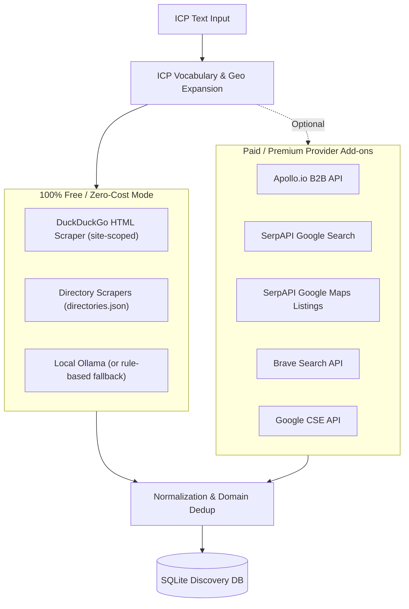

# OUTZAAR

AI-powered B2B outbound sales platform with automated company discovery engine.

---

## 📁 Repository Structure

The backend discovery engine is integrated into `backend/app/discovery/`:

```
outzaar/
├── backend/
│   ├── app/
│   │   ├── api/
│   │   │   └── routes/
│   │   │       ├── ai.py
│   │   │       └── health.py
│   │   ├── core/
│   │   │   ├── config.py
│   │   │   └── database.py
│   │   ├── discovery/                  <-- Discovery engine
│   │   │   ├── providers/              <-- Provider connectors (DDG, Apollo, SerpAPI, etc.)
│   │   │   │   ├── apollo.py
│   │   │   │   ├── base.py
│   │   │   │   ├── directories.py
│   │   │   │   └── search.py
│   │   │   ├── adapters.py
│   │   │   ├── api.py                  <-- FastAPI endpoints (/api/discovery/*, /api/prospects/*)
│   │   │   ├── config.py               <-- Discovery settings & env loader
│   │   │   ├── engine.py               <-- Orchestration & worker pools
│   │   │   ├── geo.py                  <-- Indian states, tier-1/2/3 industrial clusters
│   │   │   ├── http.py                 <-- Resilient HTTP client with retry/backoff
│   │   │   ├── icp.py                  <-- ICP interpretation & vocabulary extractor
│   │   │   ├── normalize.py            <-- Deduplication, domain cleansing & normalization
│   │   │   ├── queries.py              <-- Query matrix generator (term × type × location)
│   │   │   └── store.py                <-- SQLite data store
│   │   ├── models/
│   │   ├── schemas/
│   │   ├── services/
│   │   └── main.py                     <-- Main FastAPI entrypoint
│   └── tests/
│       └── test_discovery.py           <-- 28 discovery unit tests
├── frontend_web/                       <-- React + Vite frontend
├── data/
│   └── outzaar.db
├── .env                                <-- Environment configuration
├── requirements.txt
└── README.md
```

---

## 🚀 Quickstart Guide

### 1. Install Dependencies

```bash
pip install -r requirements.txt
pip install beautifulsoup4 lxml
```

### 2. Run Test Suite (Offline - No API keys or network required)

```bash
python -m unittest backend.tests.test_discovery
```

### 3. Start the Backend

```bash
uvicorn backend.app.main:app --reload --host 0.0.0.0 --port 8000
```

- **Interactive API Docs (Swagger)**: [http://localhost:8000/docs](http://localhost:8000/docs)
- **Active Providers Status**: [http://localhost:8000/api/discovery/providers](http://localhost:8000/api/discovery/providers)
- **Health Check**: [http://localhost:8000/api/health](http://localhost:8000/api/health)

### 4. Start the Frontend (Optional)

```bash
cd frontend_web
npm install
npm run dev
```

---

## ⚙️ Operating Modes: Free vs Paid Providers

OUTZAAR Discovery is built with a **modular provider architecture**. It automatically detects which providers are configured in `.env` and enables them accordingly.



---

### Option A: Running 100% Free (Zero Paid APIs)

You do **not** need Apollo.io or SerpAPI to discover companies. In free mode:
- **DuckDuckGo HTML Scraper (`duckduckgo_html`)**: Queries search engines with site-scoping across major Indian B2B marketplaces (**IndiaMART, TradeIndia, ExportersIndia, JustDial**) and industry export promotion councils (**FIEO, CII, FICCI, EEPC**).
- **Local Ollama AI**: Analyzes ICPs locally using `llama3.1` or `qwen3:4b` at zero cost. If Ollama is not installed or running, the engine automatically falls back to deterministic rule-based keyword extraction.

#### `.env` for Free Mode:
```env
APP_NAME=OUTZAAR
APP_ENV=development
DATABASE_URL=sqlite:///./data/outzaar.db

# Free Local AI (ICP vocabulary expansion)
OLLAMA_BASE_URL=http://localhost:11434
OLLAMA_MODEL=qwen3:4b

# Discovery settings (Free / Keyless)
DISCOVERY_ENABLE_DDG=true
APOLLO_API_KEY=
SERPAPI_API_KEY=
BRAVE_API_KEY=
GOOGLE_CSE_API_KEY=
GOOGLE_CSE_CX=

# Discovery Tuning
DISCOVERY_DB_PATH=outzaar_discovery.db
DISCOVERY_MAX_QUERIES=100
DISCOVERY_MAX_PAGES=3
DISCOVERY_WORKERS=3
```

---

### Option B: Running with Paid Providers (Apollo, SerpAPI, Brave, Google CSE)

Add keys for any paid providers you want to use. You can enable one, some, or all of them:

| Provider | What It Provides | Required `.env` Variables | Confidence |
|---|---|---|---|
| **Apollo.io** (`apollo`) | Structured B2B database: verified company names, domains, LinkedIn URLs, employee headcounts, estimated revenue | `APOLLO_API_KEY=your_key` | High |
| **SerpAPI Google Maps** (`serpapi_maps`) | Google Maps business listings: physical addresses, phone numbers, localized manufacturer names | `SERPAPI_API_KEY=your_key` | High |
| **SerpAPI Google Search** (`serpapi_google`) | High-volume Google search results with site-scoped directory queries | `SERPAPI_API_KEY=your_key` | Low (titles) |
| **Brave Search** (`brave_search`) | Commercial web search engine API with high rate limits | `BRAVE_API_KEY=your_key` | Low (titles) |
| **Google CSE** (`google_cse`) | Google Programmable Search (100 free queries/day, then paid) | `GOOGLE_CSE_API_KEY=key`<br>`GOOGLE_CSE_CX=cx_id` | Low (titles) |

#### Example `.env` with Apollo & SerpAPI enabled:
```env
# Enable Apollo and SerpAPI
APOLLO_API_KEY=your_apollo_api_key_here
SERPAPI_API_KEY=your_serpapi_api_key_here

# Leave unused providers empty
BRAVE_API_KEY=
GOOGLE_CSE_API_KEY=
GOOGLE_CSE_CX=
DISCOVERY_ENABLE_DDG=true
```

---

## 📡 Operating the Discovery Engine (API Examples)

### 1. Check Active Providers
See which providers are currently detected and ready to use:
```bash
curl http://localhost:8000/api/discovery/providers
```
*Response:*
```json
[
  {"name": "duckduckgo_html", "kind": "search", "enabled": true, "confidence": "low"},
  {"name": "apollo", "kind": "b2b_api", "enabled": false, "confidence": "high"},
  {"name": "serpapi_maps", "kind": "business_listing", "enabled": false, "confidence": "high"}
]
```

---

### 2. Launch a Discovery Run
Start a background discovery run by submitting an ICP description:

#### Free mode run (Uses DuckDuckGo + local AI/fallback):
```bash
curl -X POST http://localhost:8000/api/discovery/runs \
  -H "Content-Type: application/json" \
  -d '{
    "icp_text": "Solar panel and inverter manufacturers in Gujarat and Maharashtra",
    "max_queries_per_provider": 30,
    "target_unique": 50
  }'
```
*Response:*
```json
{"run_id": 1, "status": "running"}
```

#### Targeted run specifying providers:
```bash
curl -X POST http://localhost:8000/api/discovery/runs \
  -H "Content-Type: application/json" \
  -d '{
    "icp_text": "CNC precision machine tools in Pune and Coimbatore",
    "providers": ["duckduckgo_html", "apollo"],
    "max_queries_per_provider": 25,
    "max_pages": 3,
    "use_ollama": true
  }'
```

---

### 3. Track Run Progress & Statistics
Inspect real-time counters, deduplication rates, and provider performance:
```bash
curl http://localhost:8000/api/discovery/runs/1
```
*Response:*
```json
{
  "id": 1,
  "status": "completed",
  "raw_count": 142,
  "unique_count": 68,
  "new_count": 68,
  "duplicate_count": 74,
  "error_count": 0,
  "provider_stats": [
    {"provider": "duckduckgo_html", "done": 25, "failed": 0, "skipped": 0}
  ]
}
```

---

### 4. Fetch Discovered Companies or Export to CSV

#### View in JSON:
```bash
curl "http://localhost:8000/api/discovery/runs/1/companies?limit=20"
```

#### Download as CSV:
```bash
curl -o companies.csv "http://localhost:8000/api/discovery/runs/1/companies.csv"
```

---

### 5. Inspect Errors & Diagnostics
If any provider encountered rate limits, network timeouts, or bad API keys:
```bash
curl http://localhost:8000/api/discovery/runs/1/errors
```

---

## 🛡️ Deduplication & Resilience Rules

1. **Hierarchy of Dedup Matching**:
   - `Domain` (highest confidence, e.g. `tatamotors.com`)
   - `Provider Source ID` (e.g. Apollo organization ID)
   - `Normalized Company Name + City` (e.g. "Acme Pumps" in "Pune" != "Acme Pumps" in "Chennai")
2. **Aggregator Domain Protection**: Common portals (Indiamart, LinkedIn, Facebook, JustDial) are never saved as a company's private domain.
3. **Circuit Breakers**: If a provider fails repeatedly or returns `401 Unauthorized` (bad API key), it is gracefully switched off for that run without stopping remaining providers.
